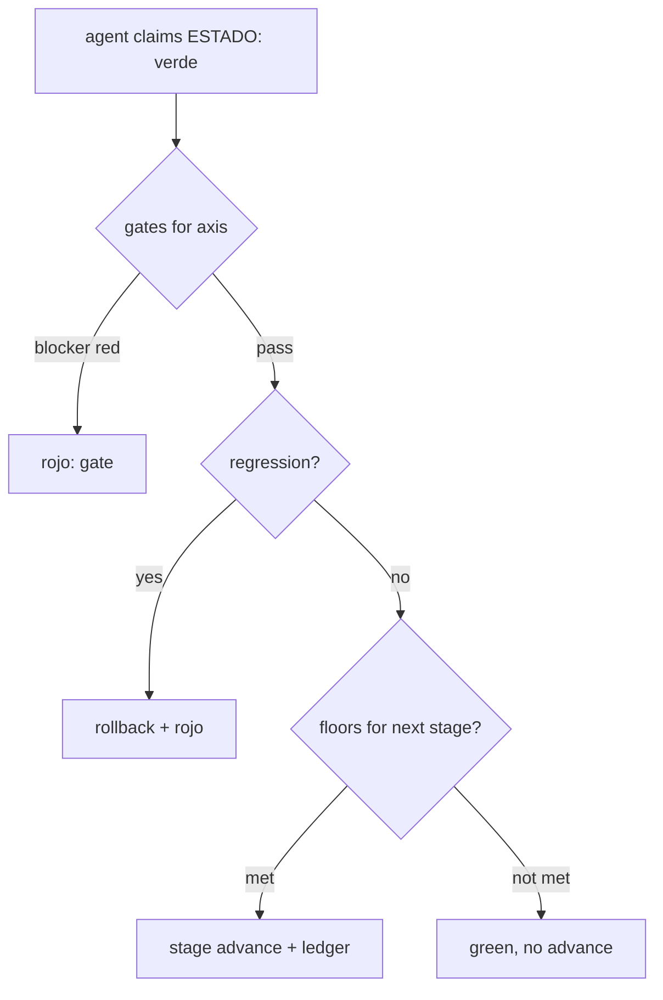

# Autonoma

[](https://github.com/LeoAra03/Autonoma/actions/workflows/ci.yml)

**A deterministic work director.** Autonoma takes a repository from *"written in one day"* to *"handed over to a team"* by running a measured ladder of quality stages — and refusing to advance on self-reported progress.

It drives a web chat agent through a dependency-ordered plan of engineering work. The director does not need to understand the code: it needs to **compare numbers and count**. The agent on the other end can be anything that can type — a human, an LLM, or a mix of both.

There is no LLM inside Autonoma. It never grades its own homework: every claim is checked by external command-line gates, and every verdict is written to a chained, tamper-evident ledger.

---

## The idea

Long refactors die from two things: nobody knows what *"better"* means, and the worker grades their own homework.

Autonoma fixes both.

- **"Better" is defined, not felt.** The scorecard is built on the nine quality characteristics of [ISO/IEC 25010:2023](https://www.iso.org/standard/78176.html), plus supply chain and handover.
- **The grade comes from outside.** Gates are plain command-line checks that either exit zero or they do not. The agent claims a result; the gates decide whether the claim survives.

If the gates fail, the phase is red and the tree rolls back. If the score drops, same. Nothing advances on a good paragraph.

## How a run works



## The ladder

| Stage | Meaning |
| --- | --- |
| **S0** | Raw. Runs, maybe. |
| **S1** | Coherent. Builds, has tests, has a README that explains it. |
| **S2** | Solid. No secrets, dependencies audited, coverage floor, reproducible build. |
| **S3** | Professional. Performance budget, keyboard paths, supply chain, runbook. |
| **S4** | Handover-ready. Threat model, SBOM, provenance, ownership map, tested restore. |

Each stage has per-axis floors. You cannot buy your way past a floor with a high average — and a **blocker** at S3 holds you at S2.

## Scoring

Eleven axes, weights in [`config/scorecard.json`](config/scorecard.json), floors in [`config/stages.json`](config/stages.json). Ten of the eleven axes come from ISO/IEC 25010:2023 — functional suitability, performance efficiency, compatibility, interaction capability, reliability, security, maintainability, flexibility and safety — plus supply chain (SLSA and OpenSSF Scorecard) and handover.

Skipped gates do not count as passes. A missing tool lowers the axis by lowering coverage, which is the point: you cannot claim S3 while `osv-scanner` is not installed.

## Gates

A gate is a command, an expectation, a severity and a weight. Gates live in [`config/gates/`](config/gates/), are matched against the files of the project by glob, and run with a timeout and an artifact directory.

```json
{
  "id": "sec-secrets",
  "cmd": "gitleaks detect --no-banner --redact --exit-code 1",
  "expect": { "exit": 0 },
  "severity": "blocker",
  "weight": 30,
  "when": ["**/*"],
  "timeout": 180
}
```

A `blocker` fails the phase regardless of score. Every run is hashed into an append-only ledger.

## Ledger

`ledger.jsonl` chains each entry to the hash of the previous one. `--verify-ledger` recomputes the whole chain, so editing a green by hand breaks it visibly.

## Requirements

- Windows 10/11 with PowerShell 5.1 or 7+
- A Chromium-based browser (Chrome, Edge, Brave, Chromium, Thorium)
- Whatever tools your gates call — nothing is bundled

## Install

```powershell
git clone https://github.com/LeoAra03/Autonoma
cd Autonoma
Copy-Item config/autonoma.example.json config/autonoma.json
```

Edit `url` and `plan`, or run discovery to generate a plan from the target project.

## Usage

```powershell
# Generate a plan from an existing project
bin\autonoma.cmd --discover -Url "https://site/chat/1"

# Run
bin\autonoma.cmd -Url "https://site/chat/1" -Plan plans\discovered-20261120\roadmap

# Inspect without sending anything
bin\autonoma.cmd -Plan plans\example\roadmap --dry-run
bin\autonoma.cmd -Plan plans\example\roadmap --score
bin\autonoma.cmd -Plan plans\example\roadmap --stage
bin\autonoma.cmd -Plan plans\example\roadmap --verify-ledger
```

## Exit contract

The agent must end each acceptance with:

```text
ESTADO: verde
EVIDENCIA: <paths and real command output>
GATES: sec-secrets, rel-tests
```

`rojo` retries the phase from part one. `bloqueado` parks the phase. A green without evidence is weak and cannot advance a stage.

## Budget and brakes

`limits.turns`, `limits.wallMinutes` and `limits.maxRegressions` stop the run when they trip. Three consecutive score regressions stop the run and write an incident note.

## Safety

The browser runs in an isolated profile under `%LOCALAPPDATA%\Autonoma\profile`. No telemetry, no keys, no external service. See [SECURITY.md](SECURITY.md).

## Limits, honestly

- It measures quality, not market fit. `VIABILIDAD.md` argues for it; it does not know.
- *"Legal"* means license compatibility and CVE checks, not legal advice.
- If the stack has no runner, the first playbook builds one. No runner, no gates, no ladder.
- The model can still lie. That is exactly why the gates are external and the ledger is chained.

## License

[MIT](LICENSE). Not affiliated with any site it drives.
